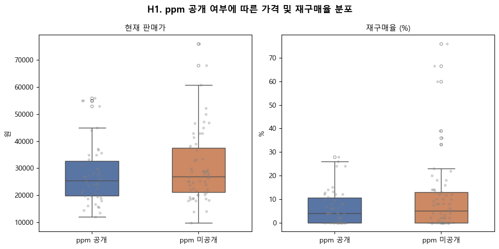
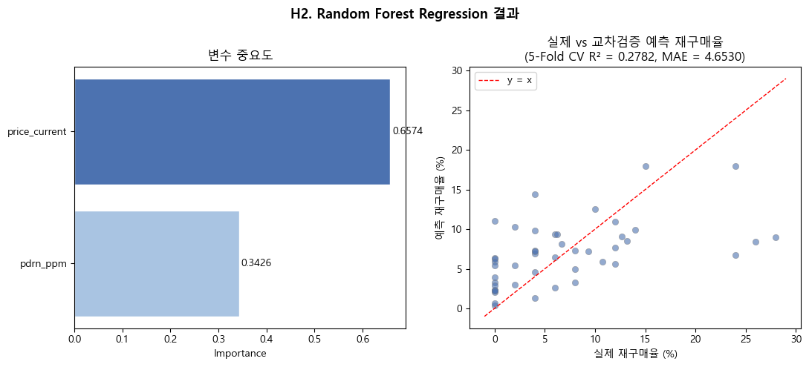
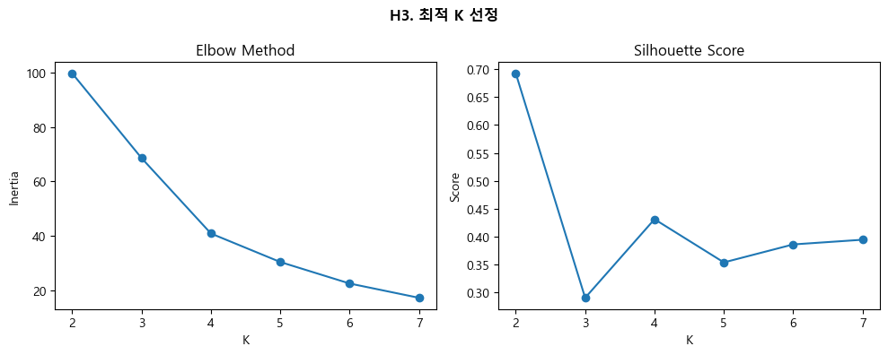
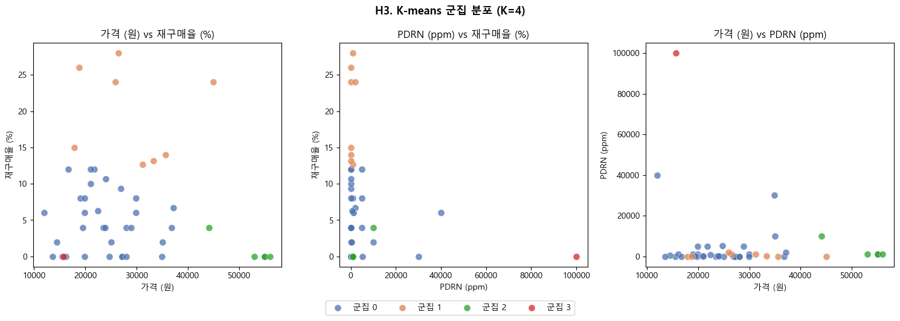

# PDRN 스킨케어 시장에서 함량 정보 공개와 소비자 반응의 관계 분석

올리브영에서 판매되는 PDRN 스킨케어 제품 데이터를 수집하여, **PDRN 함량(ppm) 공개 여부와 실제 함량이 가격 및 재구매율과 어떤 관계가 있는지** 분석한 데이터분석 프로젝트입니다.

- 📄 보고서: [report.pdf](report.pdf)
- 📓 노트북: [01_data_collection](notebooks/01_data_collection.ipynb) · [02_analysis](notebooks/02_analysis.ipynb)

## 배경

PDRN(폴리데옥시리보뉴클레오타이드, 전성분 표기명: 소듐디엔에이)을 앞세운 화장품 마케팅이 빠르게 늘고 있습니다. 그런데 전성분 표시 지침상 1% 이하 성분은 순서와 관계없이 표시할 수 있어서, 브랜드가 ppm 수치를 따로 공개하지 않으면 소비자는 실제 함량을 알 수 없습니다.

이 프로젝트는 ppm 공개를 정보 비대칭 상황의 **품질 신호(signaling)** 로 보고, 이 신호가 실제 시장에서 소비자 반응과 연결되는지 확인합니다.

## 연구 질문(가설)

| | 가설 | 결과 |
|---|---|---|
| **H1** | ppm 수치를 공개한 제품은 미공개 제품보다 평균 가격과 재구매율이 모두 유의미하게 높을 것이다 | ❌ 기각 |
| **H2** | ppm 공개 제품군에서 재구매율을 예측할 때, PDRN 함량이 가격보다 중요도가 높을 것이다 | ❌ 기각 |
| **H3** | ppm 공개 제품군을 군집화하면 "고가격·저재구매율" 군집이 독립적으로 나타날 것이다 | ✅ 채택 |

## 데이터와 방법

**데이터 수집** ([01_data_collection.ipynb](notebooks/01_data_collection.ipynb))
- 올리브영에서 'PDRN'으로 검색된 상품 159개의 브랜드, 상품명, 판매가, 전성분 텍스트를 수집했습니다.
- 재구매율: 상품별 리뷰를 최대 500개까지 조회한 뒤, 그중 '재구매'로 표시된 리뷰의 비율로 계산했습니다. 리뷰 본문이나 작성자 정보는 저장하지 않았습니다.

**전처리** ([02_analysis.ipynb](notebooks/02_analysis.ipynb))
1. 품절 상품 제거 (159 → 140개)
2. 전성분 텍스트에서 정규표현식으로 `소듐디엔에이(…ppm/ppb/%)`를 추출하고 ppm으로 환산
3. 기획 세트·용량 차이 등으로 중복 등록된 제품을 자동 및 수작업으로 통합 (140 → **107개**)
4. 함량을 표기한 제품을 공개군(46개), 나머지를 미공개군(61개)으로 분류

**분석 기법**
- H1: Welch t-test + Mann-Whitney U test (유의수준 0.05)
- H2: Random Forest Regression, 5-Fold 교차검증 및 변수 중요도
- H3: 표준화 후 K-means 군집분석 (Elbow Method와 Silhouette Score로 K 선정)

## 핵심 결과

### H1. ppm 공개 여부는 가격·재구매율 차이를 만들지 않았다

| 변수 | 공개군 평균 | 미공개군 평균 | Welch p | Mann-Whitney p |
|---|---|---|---|---|
| 가격 | 27,749원 | 30,448원 | 0.257 | 0.281 |
| 재구매율 | 6.78% | 10.70% | 0.095 | 0.550 |



### H2. 재구매율 예측에서는 함량보다 가격의 기여가 컸다

5-Fold CV 기준 R² = 0.278 (±0.148), MAE = 4.65였습니다. 변수 중요도는 **가격 0.657**, PDRN 함량 0.343으로, 가격이 함량의 약 2배였습니다.



### H3. "고가격·저재구매율" 제품군이 별도 군집으로 나타났다

Silhouette Score는 K=2에서 가장 높았지만, 군집 해석 가능성을 함께 고려해 K=4로 정했습니다.



| 군집 | 제품 수 | 평균 가격 | 평균 ppm | 평균 재구매율 | 해석 |
|---|---|---|---|---|---|
| 0 | 32 | 23,861원 | 3,383 | 4.72% | 일반 제품군 |
| 1 | 8 | 29,265원 | 513 | 19.61% | 재구매율이 높은 제품군 |
| 2 | 5 | 52,620원 | 2,800 | 0.80% | **고가격·저재구매율 (괴리 제품군)** |
| 3 | 1 | 15,700원 | 100,000 | 0.00% | 극단적 고함량 단일 제품 |



### 결론

PDRN 시장에서 함량 공개는 아직 소비자에게 일관된 품질 신호로 작동하지 않는 것으로 보입니다. 소비자 반응은 성분 함량보다 가격과 브랜드 포지셔닝의 영향을 더 크게 받았습니다.

## 한계

- **재구매율의 대리 지표 문제**: 실제 반복 구매 이력이 아니라, 최대 500개 리뷰 샘플('도움돼요 순' 정렬) 중 재구매로 표시된 리뷰의 비율입니다. 리뷰를 쓰지 않은 구매자는 반영되지 않고, 정렬 기준에 따른 샘플 편향이 있을 수 있습니다.
- **플랫폼 한정**: 올리브영 한 곳의 데이터라서 백화점이나 피부과 채널 등을 포함한 전체 시장으로 일반화하기 어렵습니다.
- **표본 크기**: 중복을 제거한 뒤 107개, H2와 H3는 46개로 표본이 작습니다. 특히 H3의 군집 2·3은 제품 수가 매우 적습니다.
- **통제하지 못한 변수**: 브랜드 인지도와 제형(에센스, 크림 등)을 모델에 넣지 않았습니다.
- **ppm 추출의 한계**: 전성분에 함량을 표기한 경우만 정규표현식으로 추출했습니다. 1건은 제품명에 표기된 함량을 직접 입력했습니다.

## 레포 구조

```
pdrn-skincare-analysis/
├── README.md
├── report.pdf                      # 보고서
├── notebooks/
│   ├── 01_data_collection.ipynb    # 수집 절차 기록 + 파싱·병합 코드
│   └── 02_analysis.ipynb           # 전처리, 가설 검정, 모델링 (실행 결과 포함)
└── figures/                        # 분석 노트북에서 내보낸 그래프
```

## 실행 환경 및 참고 사항

- Python 3, pandas, numpy, scipy, scikit-learn, matplotlib, seaborn
- **수집한 원본 데이터(`data/*.csv`)와 수집 스크립트는 포함하지 않았습니다.** 노트북은 실행 결과가 저장된 상태로 올려두었으며, 노트북은 데이터를 `data/` 폴더에서 읽도록 되어 있습니다.
- 그래프의 한글 폰트는 `Malgun Gothic`(Windows)으로 설정되어 있습니다. macOS에서는 `AppleGothic` 등으로 바꿔야 한글이 깨지지 않습니다.

## 참고 문헌

1. 고현숙 외, 「해조류에서 추출한 PDRN의 항산화, 항염증 및 주름 개선 효과」, 아시안뷰티화장품학술지 23(3), 2025.
2. 식품의약품안전처, 「화장품 전성분 표시지침」.
3. Akerlof, G. A., "The Market for 'Lemons': Quality Uncertainty and the Market Mechanism", *QJE* 84(3), 1970.
4. Spence, M., "Job Market Signaling", *QJE* 87(3), 1973.
